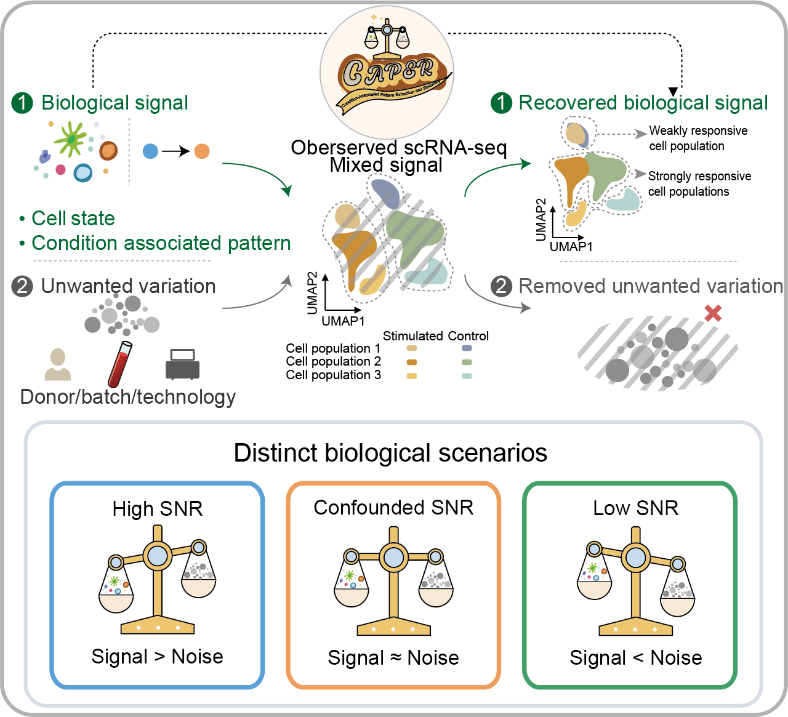

# CAPER

Single-cell RNA sequencing data analysis often faces the challenge of separating true biological signals from unwanted variation. CAPER, short for **Condition-Associated Pattern Extraction and Recovery**, is a matrix factorization framework designed to address this challenge in two-condition single-cell transcriptomics.

CAPER generates interpretable cell latent factors and batch-corrected expression matrices by disentangling condition-associated biological signals from unwanted variation. Across high, confounded, and low signal-to-noise ratio scenarios, CAPER can robustly preserve biological signals, capture cell-population heterogeneity, and enable reliable downstream analyses.

# Installation
CAPER is implemented in C++, compiled using Rcpp, and distributed as an R package.

```r
library(devtools)
install_github("liye-me/CAPER")
```

# Usage
The main function of CAPER is `CAPER_rcpp`. You can also check the function documentation in R:

```r
?CAPER_rcpp
```

## Example: PBMC IFN-β stimulation dataset
This example demonstrates how to run CAPER on a small PBMC IFN-β stimulation dataset.

The example data contain 4 scRNA-seq datasets from peripheral blood mononuclear cells (PBMCs) of 2 patients with systemic lupus erythematosus (SLE), including:

- 2 IFN-β-stimulated samples (`stim`; N = 1,109 cells), and
- 2 unstimulated control samples (`control`; N = 1,055 cells).

The biological goal of this example is to recover IFN-β-induced transcriptional responses while reducing unwanted variation.

In the full manuscript analysis, CAPER was applied to a larger PBMC IFN-β stimulation dataset. This GitHub example is provided as a lightweight tutorial to demonstrate:

1. input preparation,
2. condition-wise preprocessing,
3. CAPER model fitting,
4. corrected gene expression matrix reconstruction, and
5. extraction of condition-associated latent factors.

### Preprocessing pipeline
```r
# Load required packages.
# Seurat is used for single-cell preprocessing.
# sva is used for ComBat-based batch correction.
library(Seurat)
library(sva)

# Load the example Seurat object.
# The object should contain gene expression data and metadata,
# including condition, batch, and cell-type annotations.
object <- readRDS("/path/to/your/CAPER/inst/extdata/exampledata.rds")

# Split the Seurat object by experimental condition.
# In this example, the two conditions are IFN-β-stimulated and control samples.
objectlist <- SplitObject(object,split.by = "condition")
objectlist <- lapply(X = objectlist, FUN = function(x) {

# Preprocess each condition separately.
# This step normalizes the expression matrix, scales the data, and identifies highly variable genes within each condition.
x <- NormalizeData(x)
x <- ScaleData(x)
x <- FindVariableFeatures(x, selection.method = "vst", nfeatures = 500)
})

# Assign the two condition-specific Seurat objects.
# object_c represents condition c, usually the control condition.
# object_s represents condition s, usually the stimulated or disease condition.
object_c <- objectlist[[1]]
object_s <- objectlist[[2]]

# Extract the top highly variable genes from each condition.
hvg.c <- head(VariableFeatures(object_c), n = 500)
hvg.s <- head(VariableFeatures(object_s), n = 500)

# Use the union of highly variable genes from both conditions.
# This creates a common feature space for CAPER.
hvg.union <- union(x = hvg.c, y = hvg.s)

# Extract scaled expression matrices for the selected genes.
# CAPER requires gene-by-cell matrices as input.
X_c <- object_c@assays$RNA@scale.data[hvg.union,]
X_s <- object_s@assays$RNA@scale.data[hvg.union,]

# Perform within-condition batch correction using ComBat.
# This step reduces batch-associated unwanted variation before CAPER factorization.
X_c <- ComBat(dat=as.matrix(X_c), batch=as.character(object_c$batch), mod=NULL, par.prior=TRUE, prior.plots=FALSE)
X_s <- ComBat(dat=as.matrix(X_s), batch=as.character(object_s$batch), mod=NULL, par.prior=TRUE, prior.plots=FALSE)
```

### CAPER Model
##### Inputs
- X_c: A gene-by-cell matrix for condition c.
- X_s: A gene-by-cell matrix for condition s.
- k1: The number of global latent dimensions.
- k2: The number of condition-specific latent dimensions.
- sigma_c: The variance scale for condition c.
- sigma_s: The variance scale for condition s.
- max_iter: The maximum number of EM iterations to perform.
- epsilon: The convergence threshold for the EM algorithm.
- verbose: If TRUE, progress information will be printed during execution (default is FALSE).

##### Outputs
A list of model outputs:
- Lambda: Cell-by-latent factors
- E_Z: Posterior mean E[Z|X], where each column corresponds to a gene g.
- psi_diag: Diagonal of noise covariance.

```r
# Estimate the condition-specific variance scale.
# Here, sigma_c and sigma_s are calculated as the average per-gene variance
# in the control and stimulated conditions, respectively.
sigma_c <- mean(apply(X_c, 1, var))
sigma_s <- mean(apply(X_s, 1, var))

# Load CAPER package.
library(CAPER)

# Fit the CAPER model.
# k1 controls the dimension of condition-associated cell latent factors.
# k2 controls the dimension of unwanted variation cell latent factors.
res <- CAPER_rcpp(X_c = as.matrix(X_c), X_s = as.matrix(X_s), k1 = 30, k2 = 10, sigma_c = sigma_c, sigma_s = sigma_s, max_iter = 10000, epsilon = 0.001, verbose = FALSE)
```
### Reconstruction of gene expression matrix and extraction of cell latent factors
```r
# Set the number of global latent dimensions used for reconstruction.
k1 <- 30

# Reconstruct the CAPER-corrected expression matrix.
# The first k1 columns of res$Lambda represent global biological cell latent factors.
# The first k1 rows of res$E_Z represent the corresponding gene-level effects.
# The reconstructed matrix Xhat has cells as rows and genes as columns.
Xhat <- res$Lambda[, 1:k1, drop = FALSE] %*% res$E_Z[1:k1, , drop = FALSE]

# Add cell and gene names to the reconstructed matrix.
rownames(Xhat) <- c(colnames(X_c), colnames(X_s))
colnames(Xhat) <- hvg.union

# Create a Seurat object using the CAPER-corrected expression matrix.
Xhat_t <- t(Xhat)
correct <- CreateSeuratObject(counts = Xhat_t)
correct <- SetAssayData(correct, slot = "data", new.data = Xhat_t)
correct <- SetAssayData(correct, slot = "scale.data", new.data = Xhat_t)

# Add metadata from the original condition-specific Seurat objects.
correct <- FindVariableFeatures(correct)
correct$condition <- c(as.character(object_c$condition), as.character(object_s$condition))
correct$batch     <- c(as.character(object_c$batch),     as.character(object_s$batch))
correct$celltype  <- c(as.character(object_c$celltype),  as.character(object_s$celltype))

# Extract CAPER cell latent factors.
# These factors can be used as low-dimensional embeddings for visualization, clustering, and other downstream analyses.
X_emb_matrix <- res$Lambda[, 1:k1, drop = FALSE]
rownames(X_emb_matrix) <- c(colnames(X_c), colnames(X_s))

correct[["emb"]] <- CreateDimReducObject(
  embeddings = X_emb_matrix,
  key = "X_",
  assay = DefaultAssay(correct)
)
```

## Our group

 <https://sqsun.github.io/>.
